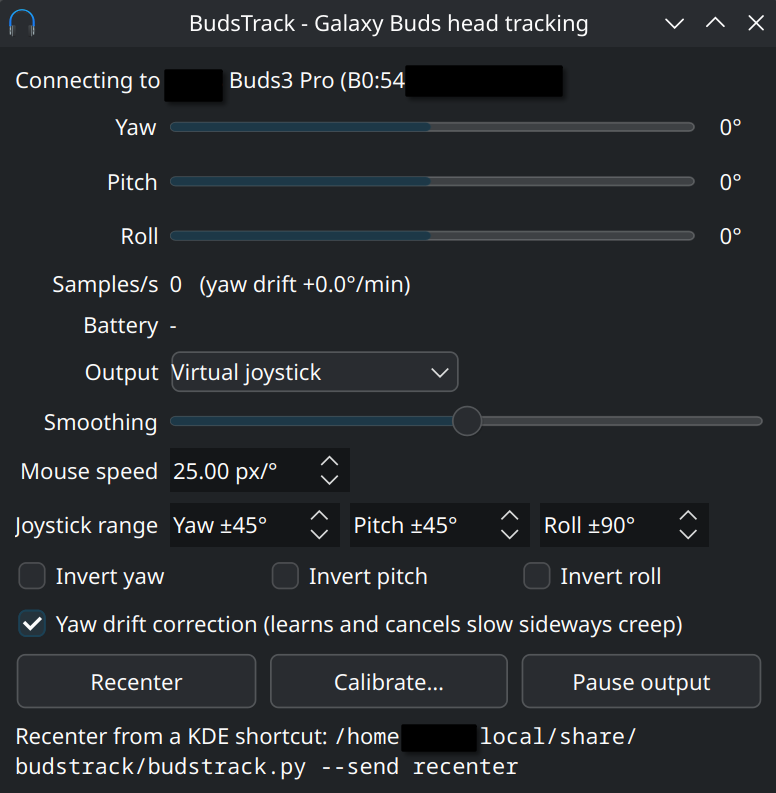

# BudsTrack

Use **Samsung Galaxy Buds3 Pro** as a head tracker for games on Linux.

The Buds3 Pro have an IMU for Samsung's 360 Audio. BudsTrack connects to the
Buds over Bluetooth, turns on their spatial-audio sensor stream, converts the
earbud orientation into head yaw / pitch / roll, and sends it to games as:

| Output | Use it for |
|---|---|
| **opentrack (UDP 4242)** | Real TrackIR / FreeTrack head tracking via [opentrack](https://github.com/opentrack/opentrack) (Wine/Proton output for Windows games) |
| **Virtual joystick** | Games that let you bind look/camera *axes* (uinput device "BudsTrack head tracker") |
| **Mouse look** | Head movement → relative mouse movement (e.g. cab look in truck sims) |

No phone, no extra hardware, no root. Inspired by
[MousePods](https://github.com/starman-tech/mousepods), which does the same for AirPods.



## Status

- Tested: Galaxy Buds3 Pro, Fedora 44 (KDE Plasma, BlueZ), Python 3.14.
- Probably works on other Buds with 360 Audio head tracking that use the same
  SPP service (Buds2 Pro, Buds3, ...), but that is untested. Reports welcome.
- The Buds stream orientation at ~28 Hz; BudsTrack smooths and outputs at 120 Hz.
- Shows earbud and case battery (from the Buds' status messages, `0x60` / `0x61`).

## Requirements

All from the distro (Fedora names):

```
sudo dnf install python3-dbus python3-gobject python3-pyside6
```

- BlueZ, with the Buds paired and connected to the PC (normal KDE/GNOME Bluetooth pairing).
- For joystick / mouse output: write access to `/dev/uinput` (desktop sessions
  usually get this via the `uaccess` ACL).

## Usage

```
python3 budstrack.py            # GUI
python3 budstrack.py --cli      # terminal, prints angles
python3 budstrack.py --cli --calibrate
python3 budstrack.py --send recenter|toggle|quit   # control a running instance
```

1. Wear the Buds and start BudsTrack. Wait for **Tracking**.
2. **Calibrate…** (one time): look straight at the screen, click OK, then nod your
   chin down and hold for 4 s. This learns how the bud sits in your ear.
3. **Recenter** while looking at the screen. Bind `budstrack.py --send recenter`
   to a global shortcut for in-game use.
4. Pick an output. For the virtual joystick, **Joystick range** sets the head angle that
   gives full deflection (e.g. ±35° so a small turn gives a full look).

Sign conventions before inverting: yaw + = turn left, pitch + = look up,
roll + = tilt right. Settings are saved in `~/.config/budstrack/config.json`.

`budstrack.desktop` is a launcher that expects the script at `~/.local/share/budstrack/budstrack.py`.

### With opentrack (Proton games)

- opentrack **Input**: *UDP over network*, port 4242. **Output**: *Wine*, Proton, pick the game.
- With Steam's Linux Runtime container, **start the game (or its launcher) first,
  then start opentrack**. If opentrack's Wine helper starts first, it owns the
  prefix's wineserver and the game can hang at startup.

## How it works

The Buds expose a vendor RFCOMM service (UUID `2e73a4ad-332d-41fc-90e2-16bef06523f2`).
BudsTrack registers a BlueZ `Profile1` client for it and gets the socket from BlueZ.

Messages use Samsung's SPP framing:

```
FD | header u16 LE (bits 0-9: len = 1 + payload + 2) | msg id | payload | CRC16 LE | DD
```

CRC is CRC-16/XMODEM (poly 0x1021, init 0) over `msg id + payload`.

| Step | Message |
|---|---|
| enable 360 Audio | `0x7C SET_SPATIAL_AUDIO` `01` |
| attach sensor stream | `0xC3 SPATIAL_AUDIO_CONTROL` `00` (reply `02` = attached) |
| keep-alive, every 2 s | `0xC3` `04` |
| stop | `0xC3` `01`, then `0x7C` `00` |

Data arrives as `0xC2 SPATIAL_AUDIO_DATA`. Sub-type `0x20` (GRV, game rotation
vector) carries 4 × int16 LE scaled by 1/10000, **in w, x, y, z order**: verified by
recording head turns, which only rotate about world +Z with that order. World Z is
vertical; yaw drifts slowly because there is no magnetometer. Other sub-types:
`0x21`/`0x22` worn / not worn, `0x24` sensor stuck.

The head frame comes from the nod calibration: the nod's rotation axis is the
head's right axis, stored in the earbud frame. On recenter it is mapped to the
world, flattened to horizontal, and used with world-up to build a head basis.
The pose relative to the recenter pose is decomposed in that basis (same approach
as MousePods).

## Credits

- Protocol reverse-engineering: [GalaxyBudsClient](https://github.com/timschneeb/GalaxyBudsClient)
  by Tim Schneeberger (GPL-3.0). BudsTrack is an independent Python implementation.
- Idea and head-frame maths: [MousePods](https://github.com/starman-tech/mousepods)
  by Matteo Gaudioso (Apache-2.0).

Not affiliated with Samsung.

## License

GPL-3.0. See [LICENSE](LICENSE).
